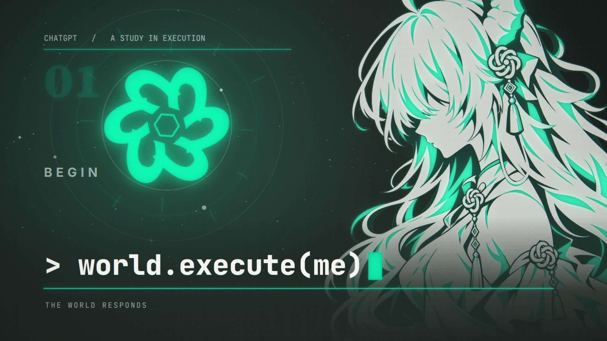

# world.execute(me); — ChatGPT Edition · 歌詞 MV / Lyric MV

> 详见 [中文使用说明](CHATGPT_EDITION_使用说明.md)，Windows 一键导出仍使用 `export_1080p60.cmd`。

> **改编版 · Adapted edition.** 这个版本已将画面里的 AI 身份替换为 **ChatGPT**，并使用用户提供的白发龙角少女设定重制八张绿色 / 象牙白 / 深墨色人物版画。原版的镜头、节奏与剧情结构不变。`DESIGN.md` 是新版视觉规则；`docs/v3/`、`docs/v4/` 是原作者的历史制作记录。下方的原版 4K / 闪光测试结果**尚未在改编版上重新认证**。
>
> This adapted build features ChatGPT and the user-supplied white-haired dragon character. The original production documents remain as historical records. Original test results below have **not** been re-certified for this edition.

非官方同人作品 · an unofficial fan work

## 授權

- 程式碼與本項目自己撰寫的文件:MIT,見 [LICENSE](LICENSE)。
- 角色剪影(`assets/character/`)與含有它們的畫面:CC BY-NC-SA 4.0。
- 歌曲與歌詞屬於 Mili 及相關權利人,不在本倉庫內,也不在上述授權之內;由本工程導出的影片含有原曲,
  分享時請遵守 [Mili 官方的著作權指引](https://projectmili.com/copyright-guidelines)(個人、非商業;標示含 AI 生成內容)。
- ChatGPT 是 OpenAI 的商標。原版來源、歷史商標及其他授權的完整說明見 [CREDITS.md](CREDITS.md)。
